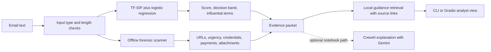

# PhishGuard Evidence — Phishing Email Screening

[](https://github.com/haarikaalla/agentic-phishing-detection-crewai-rag/actions/workflows/ci.yml)
[](https://colab.research.google.com/github/haarikaalla/agentic-phishing-detection-crewai-rag/blob/main/AgenticAI_Phishing_Detection_CrewAI_RAG.ipynb)

An evidence-first screening project that combines a trained text classifier,
deterministic email forensics, and local retrieval of defensive guidance. The
installable local application provides reproducible training, analysis, tests,
and a Gradio interface without an LLM key. The original notebook retains an
optional three-agent CrewAI explanation with Gemini.

## Project overview

The system accepts raw email text and produces:

- a phishing/spam probability from a trained text classifier;
- influential phrases supporting the prediction;
- forensic indicators such as urgency, credential requests, payment language, attachments, and shortened URLs;
- relevant defensive guidance retrieved from a local CISA, FTC, and NIST knowledge base;
- a structured evidence packet for human review;
- an optional notebook-only CrewAI explanation.

| Path | Purpose | Requirements |
|---|---|---|
| Installable local application | Train, evaluate, analyze, test, and use Gradio | Python 3.10+, no LLM key |
| Original Colab notebook | Explore the experiment and optional agent workflow | Colab; Gemini key only for CrewAI |

## Architecture



Training cleans and deduplicates emails, makes a seeded stratified 80/20 split,
fits a TF-IDF unigram/bigram plus class-weighted logistic regression pipeline,
and writes local model and metrics artifacts. CI repeats the full offline path
with a clearly labeled synthetic fixture.

## Main components

1. **Email classifier** — TF-IDF unigram/bigram features with class-weighted Logistic Regression.
2. **Explainability layer** — exposes the terms contributing toward phishing-like and legitimate-like predictions.
3. **Forensic scanner** — detects links, URL shorteners, urgency, credential requests, payment language, attachments, and capitalization patterns without visiting URLs.
4. **Local RAG** — retrieves relevant defensive passages from an inspectable knowledge base referencing CISA, FTC, and NIST.
5. **Installable CLI and Gradio app** — train, evaluate, and analyze locally without an LLM call.
6. **Notebook-only CrewAI workflow** — coordinates the three agents for an optional generated explanation.
7. **CI and tests** — verify the package on Python 3.10 and 3.13 without paid APIs.

## Validation results

The pinned run used 17,475 cleaned messages from
[`zefang-liu/phishing-email-dataset`](https://huggingface.co/datasets/zefang-liu/phishing-email-dataset)
at revision `34085a032c123ca237f314a01a67909cdea35e34` and seed `42`.

| Measurement | Result |
|---|---:|
| Training samples | 13,980 |
| Held-out test samples | 3,495 |
| Accuracy | 98.45% |
| Average precision | 0.9980 |
| Phishing/spam precision | 97.35% |
| Phishing/spam recall | 98.54% |
| Phishing/spam F1 | 97.94% |

The [committed metrics](results/heldout_metrics.json) include the cleaned-data
SHA-256 fingerprint, confusion matrix, split policy, and source revision. These
are random-split text-classification results. They do not establish performance
on new campaigns or providers; the `0.35` and `0.65` review bands are
demonstration thresholds, not calibrated operational policy.
See the [model card](docs/MODEL_CARD.md) for intended use and failure modes.

## Run locally

```bash
git clone https://github.com/haarikaalla/agentic-phishing-detection-crewai-rag.git
cd agentic-phishing-detection-crewai-rag
python3 -m venv .venv
source .venv/bin/activate      # Windows: .venv\Scripts\activate
pip install -e ".[dev,ui]"
pytest -q

# Offline smoke test using 24 synthetic example messages:
phishguard train --csv examples/demo_emails.csv --output artifacts
phishguard analyze --model artifacts/phishing_model.joblib \
  --text 'URGENT: verify your password at http://bit.ly/example-login'
phishguard serve --model artifacts/phishing_model.joblib
```

Open `http://127.0.0.1:7860` for the local Gradio interface. The 24 example
emails are artificial and exist only to test the workflow. Their evaluation
score is **not** evidence of real phishing detection quality.

To reproduce the measured public-data result instead:

```bash
pip install -e ".[data,ui]"
phishguard train --huggingface \
  --revision 34085a032c123ca237f314a01a67909cdea35e34 \
  --output artifacts
phishguard serve --model artifacts/phishing_model.joblib
```

The public dataset download requires internet access. Training creates
`artifacts/phishing_model.joblib` and `artifacts/metrics.json`; these generated
files are ignored by Git. `joblib` uses pickle internally, so load only model
files you trained or otherwise trust. Compare the run's metrics and fingerprint
with [the committed evaluation](results/heldout_metrics.json).

## Run the optional notebook in Google Colab

1. Click **Open in Colab** above.
2. Run the installation cell once.
3. Choose **Runtime → Restart session**.
4. Continue from section 2.
5. To enable the CrewAI explanation, add `GEMINI_API_KEY` in Colab's **Secrets** panel and enable notebook access.
6. Run the remaining cells and open the inline or temporary Gradio link.

The notebook's deterministic result works without an API key. Gemini is used
only for its three-agent generated assessment. The installable CLI and local
Gradio application never call Gemini or CrewAI.

## API-key safety

No API key is stored in this repository. The notebook reads `GEMINI_API_KEY`
from Colab Secrets at runtime. Never paste an API key into a notebook cell,
commit it to Git, or include it in screenshots.

## Example phishing message

```text
Subject: URGENT — Your account will be suspended

We detected unusual activity. Verify your password immediately at
http://bit.ly/example-login. Failure to act within 2 hours will permanently
suspend your mailbox.
```

The system should identify urgency, credential language, account suspension, and a shortened URL as risk indicators. URLs are treated as text and are never visited.

## Dataset

The notebook and CLI use
[`zefang-liu/phishing-email-dataset`](https://huggingface.co/datasets/zefang-liu/phishing-email-dataset).
The positive label follows the dataset's phishing category, which can include
spam-like content. The model predicts **phishing/spam-like text**, not a
forensic determination of targeted phishing. The CLI removes exact normalized
text duplicates before splitting, but near-duplicate campaigns can remain.

## Limitations

- The public email corpus contains historical data and may not represent modern campaigns.
- Random splitting can overestimate performance when near-duplicate messages exist.
- Text alone cannot validate SPF, DKIM, DMARC, domain age, redirects, attachments, or mailbox telemetry.
- TF-IDF models can be affected by novel wording and obfuscation.
- Feature weights represent learned associations, not causal proof.
- LLM-generated explanations can make mistakes and must remain grounded in retrieved and deterministic evidence.
- The prototype must not automatically delete email, block senders, or make consequential security decisions without human review.
- The local guidance passages are curated summaries, not live website content;
  review them when source guidance changes.
- The local Gradio interface has no user authentication. Keep it bound to
  localhost and do not paste confidential mail into a public share link.

## Engineering and verification

- Installable package with separate `train`, `analyze`, and `serve` commands.
- Fixed dataset revision, cleaned-data SHA-256 fingerprint, recorded seed and
  split policy, and committed evaluation metrics.
- Input limit of 50,000 characters and no URL visits during analysis.
- Automated tests for training artifacts, CSV validation, evidence generation,
  forensic indicators, guidance retrieval, and the CLI workflow.
- CI checks Python 3.10 and 3.13, runs an offline end-to-end smoke test,
  and verifies that the Gradio UI starts on Python 3.13.

## Recommended extensions

- Parse email headers and incorporate SPF/DKIM/DMARC evidence.
- Evaluate with campaign-, sender-, or time-based splits.
- Compare with calibrated transformer models.
- Add multilingual and adversarial-obfuscation testing.
- Use a versioned organizational knowledge base and analyst feedback loop.
- Add monitoring, audit logs, drift detection, and human approval gates.

## References

- [CrewAI documentation](https://docs.crewai.com/)
- [CISA phishing guidance](https://www.cisa.gov/secure-our-world/recognize-and-report-phishing)
- [FTC phishing guidance](https://consumer.ftc.gov/articles/how-recognize-avoid-phishing-scams)
- [NIST phishing guidance](https://www.nist.gov/itl/smallbusinesscyber/guidance-topic/phishing)
- [NIST SP 800-61 Rev. 3](https://csrc.nist.gov/pubs/sp/800/61/r3/final)

## Responsible use

This repository is an educational decision-support prototype. Do not paste confidential email into a public Gradio share link, click extracted URLs, or use the system as the sole basis for security action.
